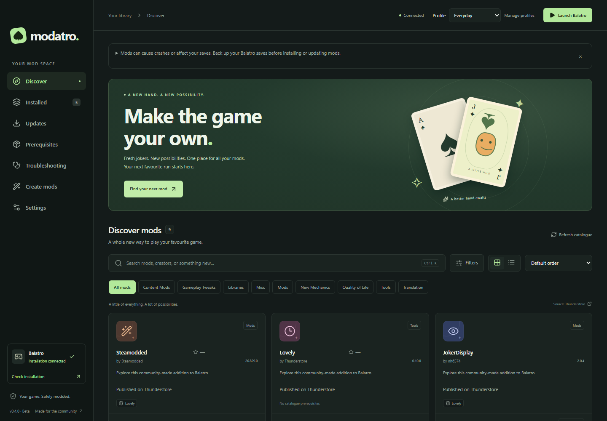
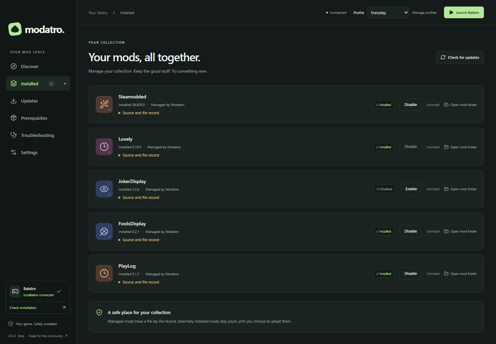
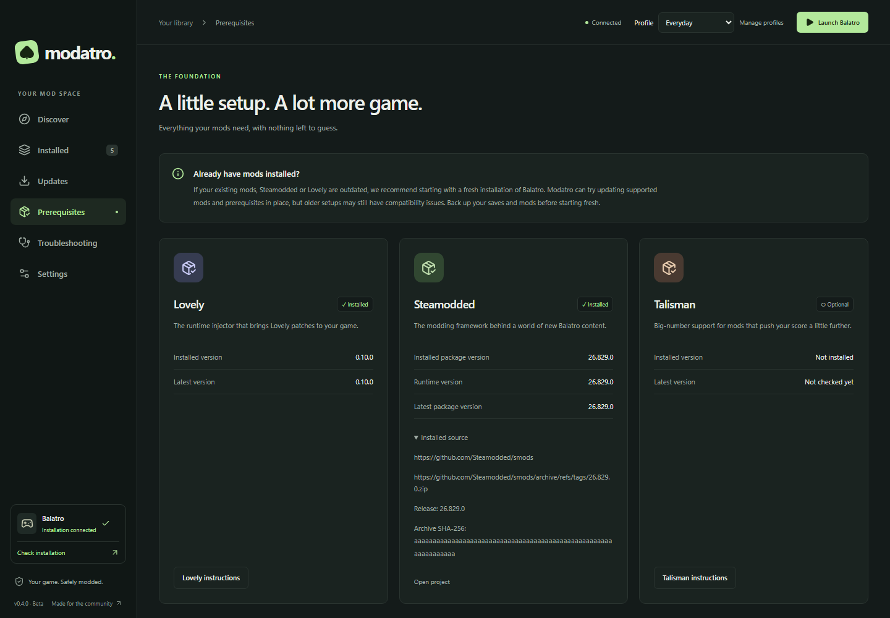
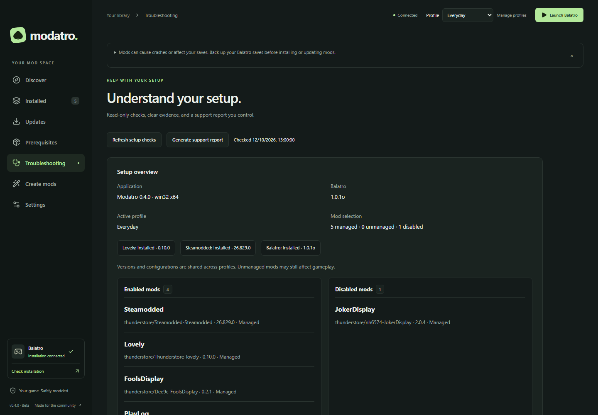

# Modatro

**An independent community mod manager for Balatro.** Discover mods, check their
requirements, and manage your collection with backups and a record of every file change.

**Beta · Windows · macOS · Linux / Steam Deck**

[Download Modatro](https://github.com/NorthernBranch/modatro/releases) ·
[Report an issue](https://github.com/NorthernBranch/modatro/issues) ·
[Contribute](CONTRIBUTING.md)

| Your collection                                                                                                      | Prerequisite checks                                                                                                                |
| -------------------------------------------------------------------------------------------------------------------- | ---------------------------------------------------------------------------------------------------------------------------------- |
|  |  |

Screenshots use representative catalogue and installation data. Click the smaller
images to view them at full size.

## Download

Choose an installer from [GitHub Releases](https://github.com/NorthernBranch/modatro/releases):

| Computer                | Installer                           |
| ----------------------- | ----------------------------------- |
| Windows, x64            | `Modatro-Setup-<version>.exe`       |
| Apple Silicon Mac       | `Modatro-<version>-arm64.dmg`       |
| Intel Mac               | `Modatro-<version>-x64.dmg`         |
| Linux / Steam Deck, x64 | `Modatro-<version>-x86_64.AppImage` |
| Debian / Ubuntu, x64    | `Modatro-<version>-amd64.deb`       |

The desktop app includes its runtime; you do not need Node.js or pnpm to use it.
Each successful release includes SHA-256 checksums and macOS signing reports.

> **Platform testing:** Windows has received the most complete manual testing.
> Feedback from macOS, Linux and Steam Deck users is welcome through
> [GitHub Issues](https://github.com/NorthernBranch/modatro/issues).

Windows beta installers are unsigned. macOS packages use verified ad-hoc signatures
unless Apple signing credentials are configured; ad-hoc builds are not notarized
and macOS may block opening them. Check the release notes and
[installation guide](docs/release.md) for the build's actual signing status.

## What Modatro does

- **Discover:** browse the live [Thunderstore Balatro catalogue](https://thunderstore.io/c/balatro/),
  search and filter mods, and sort by available GitHub star counts. The last validated
  catalogue remains available offline.
- **Additional sources:** optionally add a Balatro mod index by GitHub repository
  URL. Listings are fetched at runtime and deduplicated, with Thunderstore preferred.
  Details and install previews identify the source used.
- **Dependencies:** check installed versions, review required supported dependencies,
  and install them before the requested mod in one transaction. Check the proposed
  changes against other installed mods, choose published versions, or explicitly
  try an upstream development build.
- **Prerequisites:** detect and manage Lovely and Steamodded, including supported
  Lovely installation on Windows, macOS and Linux with Proton. Talisman is optional
  unless a mod requires it.
- **Your collection:** install, update, enable, disable and uninstall supported mods,
  or adopt identified existing copies. File records and required backups support
  recovery. Restore a recently uninstalled mod from its local backup, including
  builds no longer available online. Temporary uninstall backups are limited to 20
  copies and 1 GiB, with protected originals retained; review storage or delete copies
  in **Installed → Recently uninstalled**.
- **Profiles:** save and switch managed selections, or export/import profiles for
  backup and sharing. Versions and mod settings are shared across profiles.
- **Troubleshooting:** check your setup and prepare an editable support report,
  with log excerpts included only when you select them.
- **Mod Creator (experimental):** build Jokers, Decks and Vouchers or write Custom
  Lua, choose artwork, and export local mods. Enable it in Settings after
  acknowledging the risks.
- **Application settings:** choose Modatro Light, Modatro Dark, Balatro Light or
  Balatro Dark under **Settings → Appearance → Theme**. Match system switches between
  the Modatro themes. Both Balatro themes add pixel typography, raised controls and
  card-table colours, with a bundled font that works offline.
  App updates appear as a quiet notice; downloading and installing them remains your choice.

## Get started

1. Install Modatro, back up your Balatro saves, and close Balatro before changing mods.
2. Select your Balatro installation during setup. Use Steam discovery or choose
   the game folder manually; the game and Mods folders remain separate.
3. Open **Prerequisites** to check Lovely, Steamodded and any additional requirements.
4. Browse **Discover**, open a mod's details, and review its installation plan
   when prompted. Required supported dependencies are installed after confirmation.
5. Use **Installed** to manage your collection and **Updates** to check mod versions.

Add or remove an optional index under **Settings → Mod sources**. The URL can include
`/tree/branch`; compatible indexes contain `mods/<id>/meta.json`. Removing an index
does not remove installed mods. Local ZIPs and explicit definitions are available
under **Settings → Advanced**.

If you already have outdated mods or loaders, starting with a fresh Balatro
installation is recommended. Back up saves and mods first. Modatro can try supported
updates in place, but older setups can still have compatibility problems.

On Steam Deck, use Desktop Mode and follow the [Steam/Proton setup guide](docs/linux.md).
For application updates, use **Settings → Application updates → Download update**,
then close Modatro and run the new installer. Keep application data and backups.

## Create a local mod

Enable **Settings → Experimental features → Mod Creator**, then open **Create mods**.
Create a project, save the draft, build it and install that build explicitly.
Editing source never updates installed files until you choose Install changes.
Generated mods target Steamodded 26.1002.0 and require Lovely; syntax/package validation
does not prove safety or in-game compatibility. See the [creator guide](docs/mod-creator.md)
for builders, Custom Lua, artwork, source history, restoration and export.

## Documentation and contributions

| Mod profiles                                                              | Troubleshooting                                                                                           |
| ------------------------------------------------------------------------- | --------------------------------------------------------------------------------------------------------- |
|  |  |

These screenshots use representative selections and synthetic diagnostics.
Additional screenshots: [switch preview](docs/images/profile-switch.png),
[Settings](docs/images/settings.png) and [Updates](docs/images/updates.png).
Open profiles beside **Launch**, and **Troubleshooting** in the sidebar.

| Guide                                      | Covers                                                                |
| ------------------------------------------ | --------------------------------------------------------------------- |
| [Troubleshooting](docs/troubleshooting.md) | Setup, dependencies, rate limits, changed files and recovery          |
| [Mod Creator](docs/mod-creator.md)         | Dedicated builders, Custom Lua, artwork, builds and local ZIP exports |
| [Profiles](docs/profiles.md)               | Named selections, shared files, unsaved changes and safe switching    |
| [Releases](docs/release.md)                | Downloads, supported formats and release workflow                     |
| [Linux and Steam Deck](docs/linux.md)      | AppImage / DEB installation and Proton integration                    |
| [Signing](docs/signing.md)                 | Actual release signing status and maintainer setup                    |
| [Contributing](CONTRIBUTING.md)            | Development, checks, packaging and screenshot capture                 |
| [Architecture](docs/architecture.md)       | Services, provider boundaries and transactions                        |
| [Verification](docs/verification.md)       | Automated coverage and manual testing limits                          |
| [Catalogue](catalogue/README.md)           | Metadata, permissions, exceptions and removal feeds                   |
| [Website](docs/website.md)                 | Platform downloads, Cloudflare Pages and domain setup                 |

Mods are third-party code. Modatro checks metadata, paths and file integrity; it
does not certify mod safety or guarantee that mods work together. Authors retain
ownership, and verified removal requests stop future downloads without remotely
changing installed copies. Read the [content and removal policy](docs/content-policy.md).

Modatro is licensed under [MIT](LICENSE). Creator dependency notices are included in
[THIRD_PARTY_NOTICES.txt](THIRD_PARTY_NOTICES.txt). It is not affiliated with, endorsed by,
or sponsored by LocalThunk or Playstack.
