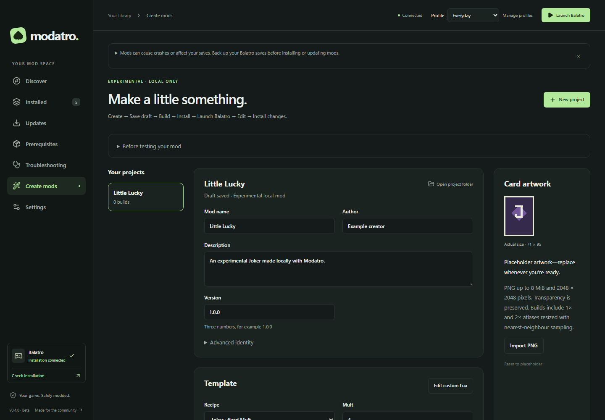

# Experimental Mod Creator

Mod Creator is a small, local Steamodded project editor. Enable it under
**Settings → Experimental features → Mod Creator**, acknowledge the disclaimer,
then open **Create mods** in the sidebar. It is off by default. Disabling it keeps
projects and installed mods; normal Installed actions remain available.

## Before testing

Mods can cause crashes or affect your saves. Back up your Balatro saves before
installing or updating mods. Close Balatro and copy the entire save-data folder,
including numbered profile folders, to a separate location:

| Setup          | Usual save-data folder                                                  |
| -------------- | ----------------------------------------------------------------------- |
| Windows        | `%APPDATA%/Balatro`                                                     |
| macOS          | `~/Library/Application Support/Balatro`                                 |
| Steam / Proton | The selected prefix's `drive_c/users/steamuser/AppData/Roaming/Balatro` |

Custom setups can differ. Modatro's file backups cover managed mod/game-file changes,
**not Balatro saves**. The main reminder is dismissible; restore it under
**Settings → Balatro saves → Show reminder again**. No automatic save backup exists.

Custom Lua runs as code in the game. Use only code you trust. Syntax validation
cannot establish safety, compatibility or correct gameplay. The full disclaimer
remains under **Before testing your mod** in the creator.

## Create, save, build and install

1. Choose **New project**, enter a name and author, and select a recipe.
2. Edit the description, three-part version and template options. **Advanced identity**
   exposes the generated mod ID and prefix. Collisions with active projects and
   detected installed mod metadata are rejected. Identities are fixed after the
   first build; create a new project for a different identity.
3. **Save draft** stores source and project settings, without touching installed files.
4. **Build mod** checks the saved metadata and Lua syntax and creates a ZIP. Unsaved
   edits must be saved first. Validation and build messages do not mean tested in-game.
5. **Install build** or **Install changes** uses Modatro's existing dependency, file
   ownership, game-closed, backup and transaction checks. Resolve missing prerequisites
   using the normal prerequisite actions, then retry. Known incompatible versions block
   installation; unknown installed loader versions use the existing explicit consent flow.
6. **Launch Balatro**, test the mod yourself, close the game, then edit, save, build
   and install changes explicitly. There is no hot reload.

Installed mods show **Locally created · Experimental**, the project ID and the exact
build hash in their source record. A catalogue release cannot overwrite that managed
project. Profiles share its installed version, just as they share other mod versions.

## Supported recipes

Templates target **Steamodded 26.1002.0** and require Lovely. The metadata, atlas
registration and calculation contexts were checked against upstream documentation
and the tagged Steamodded source. They have **not been tested in a running game**
as part of this change; try them with backed-up saves and report actual results.

| Recipe                   | Effect and creator limits                                                                   |
| ------------------------ | ------------------------------------------------------------------------------------------- |
| Blank                    | Registers the card atlas, without gameplay objects; a starting point for trusted custom Lua |
| Joker · fixed Mult       | Adds 0–1,000 Mult during Joker scoring for each played hand                                 |
| Joker · fixed Chips      | Adds 0–100,000 Chips during Joker scoring for each played hand                              |
| Joker · scored suit Mult | Adds 0–1,000 Mult for each scored card matching the selected suit, including retriggers     |
| Deck · starting bonuses  | Adds $0–1,000 starting money and 0–10 hands/discards per round when starting a new run      |

Only whole, nonnegative bonuses are supported. These are conservative creator
limits, not Steamodded guarantees of balance or compatibility. Decks use the normal
`SMODS.Back.config` bonuses, rather than patching game source or replacing run totals.
Joker descriptions are generated from the selected effect values.

References: [mod metadata](https://docs.smods.dev/API%20Documentation/Mod-Metadata/),
[Jokers](https://docs.smods.dev/Game%20Objects/SMODS.Center/SMODS.Joker/),
[calculation contexts](https://docs.smods.dev/API%20Documentation/Calculate-Functions/),
[decks](https://docs.smods.dev/Game%20Objects/SMODS.Center/SMODS.Back/),
[atlases](https://docs.smods.dev/Game%20Objects/SMODS.Atlas/) and
[tagged deck integration](https://github.com/Steamodded/smods/blob/26.1002.0/lovely/back.toml).

## Lua and external editors

Template mode owns the generated `main.lua`; the editor highlights it but keeps it
read-only. **Edit custom Lua** preserves that source and allows editing or pasting.
A pasted fragment may need surrounding code and additional dependencies. Extra
dependencies for custom code must currently be installed manually; the creator
declares Steamodded and Lovely only.

The lightweight editor parses LuaJIT syntax with `luaparse` and reports filename,
line and column. It does not execute Lua inside Modatro or Electron. LuaJIT-specific
extensions and game APIs can still differ from what the parser accepts, including
non-ASCII identifiers. Source is limited to 128 KiB of text.

**Return to template** requires confirmation. The current custom source is saved
before regeneration and preserved in the project's `history` folder. Arbitrary Lua
is never converted back into form controls. Navigation and closing the desktop
window protect unsaved work.

**Open project folder** opens the editable directory. External `main.lua` edits load
as custom code. Use **Reload from disk** before building, then save the draft.
A stale save is rejected instead of overwriting changed disk files; the current
editor buffer remains available to copy elsewhere. Treat `project.json` and `art/`
as internal state, rather than editing them while Modatro is working.

## Artwork

Import a static PNG up to **8 MiB**, with dimensions from 1×1 to **2048×2048**.
The original file stays in the project. Zoom and horizontal/vertical crop controls
select the 71:95 card area; the preview shows the actual 71×95 size. Save before
importing, replacing or resetting artwork.

Builds preserve transparency and use nearest-neighbour resizing for
`assets/1x/card.png` (71×95) and `assets/2x/card.png` (142×190). Original uploads and
their ancillary metadata are excluded from exports. Animated PNGs are unsupported.

Without an import, Modatro generates original placeholder artwork: a geometric J
card or patterned deck back. Placeholders are allowed in installs and exports and
released under [CC0 1.0](https://creativecommons.org/publicdomain/zero/1.0/); each ZIP
includes that permission. This does not license your code or imported artwork.
Use artwork you have permission to redistribute.

## Builds, restoration and export

**Build history and export** lists retained immutable builds. **Install this build**
restores an earlier revision through the normal update workflow. Enable a disabled
installed mod before replacing it. Draft edits do not change retained build ZIPs.
Failed installations use the existing rollback/recovery journal; source projects
and previous builds are outside the installation destination. Keep application data
if recovery is blocked by changed files or missing backups.

**Export ZIP** writes only `mod.json`, `main.lua`, both atlas PNGs, a short README
and the artwork permission file under the mod-ID folder. It excludes editor state,
absolute paths, original artwork, source history and file-operation backups. Save
outside game, Mods and Modatro data folders. An exported ZIP can be installed through
**Settings → Advanced → Install from file / Add mod definition**, preserving the
existing local ZIP workflow. Imported arbitrary Lua does not become a visual project.

Uninstalling an installed mod leaves its editable project and build ZIPs intact.
**Archive project** moves the editable directory to `creator/deleted/` within
Modatro's data folder; it does not uninstall anything. Retained build ZIPs live in
`creator/builds/<project-id>/`. Copy an archived UUID project directory back into
`creator/projects/<project-id>/` with Modatro closed if you need it again. Projects
and build history are local, unencrypted files; back up the application-data folder
separately. Limits are 200 active projects and 1,000 builds per project.
