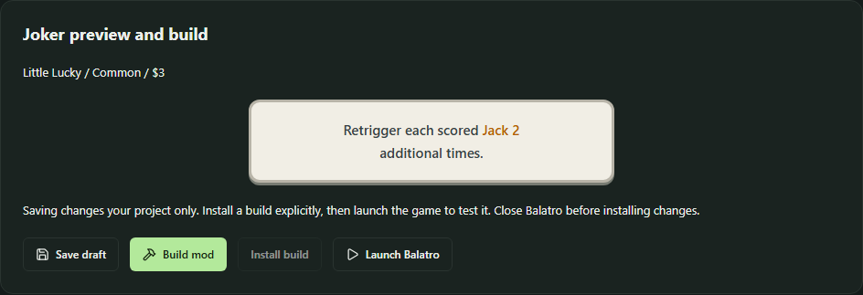
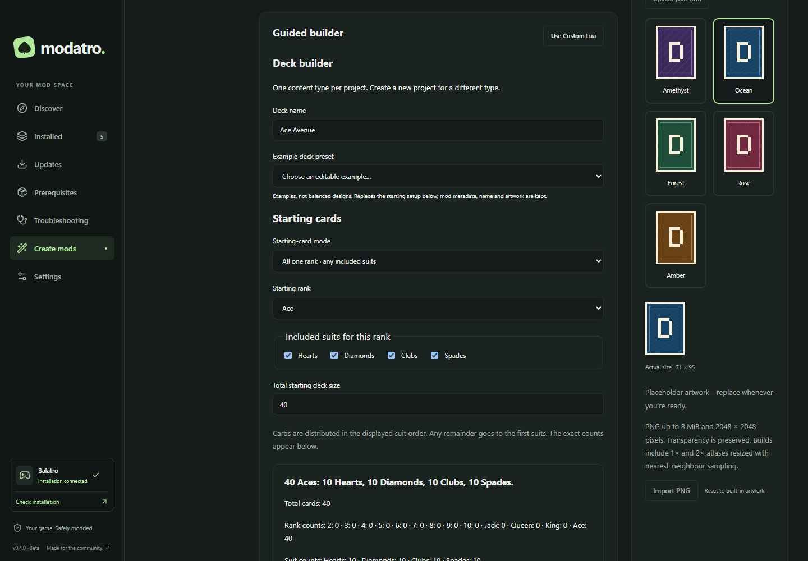
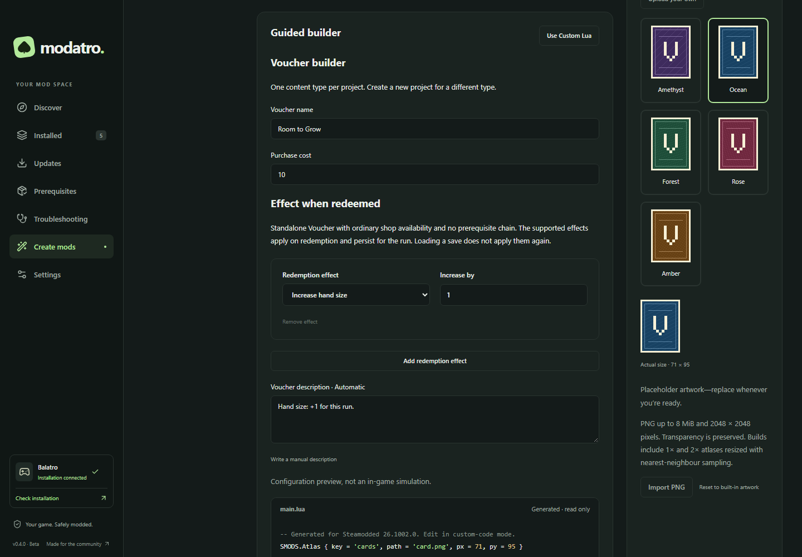

# Experimental Mod Creator

Enable **Settings → Experimental features → Mod Creator**, acknowledge the risks,
then open **Create mods**. It is off by default. Disabling it preserves projects,
installed copies and builds. The one-time introduction never enables it for you.

## Choose a workspace

**New project** offers **Joker**, **Deck**, **Voucher** and **Custom Lua** workspaces.
A project keeps its content type; create another project for a different type.
Mod name, author, version, ID and description are separate from content settings.
IDs and prefixes become fixed after building. Guided descriptions update with
configuration; manual overrides remain until **Restore automatic description**.
Previews describe configuration, not a simulation proving compatibility.

### Jokers

Choose rarity, shop cost and artwork. Common/Uncommon/Rare/Legendary map to
Steamodded rarities 1/2/3/4. Legendary uses The Soul's pool rather than ordinary
shop rolls; other mods may change acquisition.

| When                    | Optional conditions (ALL)                                                                              | Then                                 |
| ----------------------- | ------------------------------------------------------------------------------------------------------ | ------------------------------------ |
| Each played card scores | Ranks, suits, face card, first/last scoring card, resolved hand, card counts, remaining hands/discards | +Chips, +Mult, XMult, retrigger card |
| Main Joker scoring      | Resolved hand, card counts, remaining hands/discards                                                   | +Chips, +Mult, XMult                 |
| Round ends              | Remaining hands/discards                                                                               | Earn money                           |

Within rank/suit selections, any selected value matches. Suit checks use the game's
helper for Wild/suitless behaviour; ranks exclude rankless cards and face checks use
the face-card helper. Resolved hand matching is exact: Flush does not mean Straight
Flush or “contains a Flush”. Add, duplicate, delete and reorder rules; matching
effects resolve top to bottom, so +Mult then ×Mult differs from the reverse order.
Card retriggers repeat per-card effects; main scoring follows Joker evaluations.
Round rewards exclude individual held-card, repetition and game-over contexts.
Advanced compatibility flags describe generated fixed effects, not custom Lua.

**Retrigger scored card** adds 1–10 extra scoring passes per matching card. For
example, select Jacks under ranks and two additional retriggers. Multiple matching
rules add together; card scoring and per-card Joker effects repeat, not the entire
hand. First/last means scoring-card order. Remaining hands is checked after spending
the played hand, so zero targets the last hand of the round.

Automatic Joker descriptions use standard Chips, Mult, money and keyword highlights,
including the X Mult badge. The preview approximates this styling; manual descriptions
accept Balatro formatting codes and are preserved. Existing builds stay unchanged
until you explicitly save, build and install an updated draft.

### Decks

Decks use starting-setup controls, without scoring rules:

- **Standard:** no composition override; 52 base-game cards.
- **Modify standard:** included ranks × suits × copies determines size. Removing
  face cards synchronises Jacks, Queens and Kings with the rank selection; it does
  not interpret other mods' face-card effects.
- **All one rank:** editable total spread across selected suits in displayed order;
  remainders go to the first suits. Exact counts are shown.
- **All one specific card:** editable copies of one rank and one suit.

The summary includes total, rank/suit counts and an expandable card list. Empty,
fractional and over-260-card setups are rejected. Small decks receive a warning;
editable presets are examples, not balanced designs.

Starting money changes the initial balance once. Hands/discards adjust each round's
allowance; hand size and slots remain adjusted for the run. Values are relative,
with a base-game preview; stakes and other mods can change results. Reset restores
resource/capacity defaults. Advanced starting items offer six vanilla Jokers and nine
Tarot/Planet consumables with search and quantity/capacity checks. Overflow is rejected,
never discarded or made Negative. Third-party starting items are not discovered.

Native new-run setup creates composition and items once. Continuing a save keeps
its cards and modifiers. Custom composition uses explicit base-game card prototypes;
other mods that change starting cards or resources can conflict.

### Vouchers

Set name, purchase cost, artwork and distinct redemption effects: increase hand
size, hands/discards per round, Joker slots or consumable slots. Whole increases
from 1–10 are supported. Redemption updates the run once and persists with it;
loading does not apply it again. Hands/discards change future round allowances,
**without immediately granting remaining hands/discards**. These are ordinary
standalone Vouchers, without custom rarity, chains or shop weights.

### Custom Lua

This separate workspace shows mod metadata and a source editor,
without guided content controls. Modatro never decodes Lua into forms or infers
compatibility. Syntax checking uses `luaparse` without executing code; the limit
is 128 KiB. Additional dependencies need manual installation. An optional bundled
atlas is available; other assets are outside this editor.

**Use Custom Lua** preserves a guided project's generated source. Returning to its
guided builder requires confirmation and saves custom source in history first.
External `main.lua` edits also open as custom code. Reload before saving external
changes; stale writes and unsaved navigation/window closing are guarded.

## Artwork, migration and builds

Each type has five original CC0 designs: **J**, **D** or **V** in Amethyst, Ocean,
Forest, Rose and Amber. Choose a built-in or upload a static PNG (8 MiB maximum,
up to 2048×2048), then crop, pan and zoom. Transparency and originals are preserved,
including when switching to a built-in. Builds contain 71×95 and 142×190 atlases
with matching Lua references. Use uploaded artwork you may redistribute.

Existing projects upgrade to schema 2 after backing up metadata, Lua and original
artwork in `history/migration-v1/`. Joker recipes become equivalent rules; deck
bonuses, IDs, installed relationships and custom code remain unchanged. Migration
never regenerates source or replaces installed builds. Legacy placeholders remain
selected until explicitly replaced, including older deck artwork.

**Save draft → Build mod → Install build → Launch Balatro** remain explicit actions.
Saving never changes installed copies. Installation reuses dependency, ownership,
game-closed, backup and rollback checks. Build history can restore previous immutable
revisions. Uninstall preserves source and builds; archiving moves source into
`creator/deleted/` without uninstalling. Projects and builds are local files; back up
application data separately.

**Export ZIP** prompts for a destination and includes metadata, Lua, two atlases,
README and artwork permission only. Project state, originals, history, backups and
machine paths are excluded. Back up Balatro saves separately: Modatro's mod-file
backups do not include them. Settings contains save locations and the option to
restore the dismissible backup reminder.

## Verification boundary

Hooks were checked against **Steamodded 26.1002.0**, its tagged integration and the
local game's setup/redemption source. Tests cover generation, a test-only Lua contract
harness, migrations, artwork, installation, rollback, export and renderer flows.
**No representative in-game acceptance run has been completed.** Syntax and harness
checks do not prove gameplay compatibility or safety.

References: [Jokers](https://docs.smods.dev/Game%20Objects/SMODS.Center/SMODS.Joker/),
[contexts](https://docs.smods.dev/API%20Documentation/Calculate-Functions/),
[text styling](https://docs.smods.dev/Guides/Text-Styling/),
[Backs](https://docs.smods.dev/Game%20Objects/SMODS.Center/SMODS.Back/),
[Vouchers](https://docs.smods.dev/Game%20Objects/SMODS.Center/SMODS.Voucher/),
[atlas source](https://github.com/Steamodded/smods/blob/26.1002.0/src/game_object.lua),
[new-run integration](https://github.com/Steamodded/smods/blob/26.1002.0/lovely/playing_card.toml).
