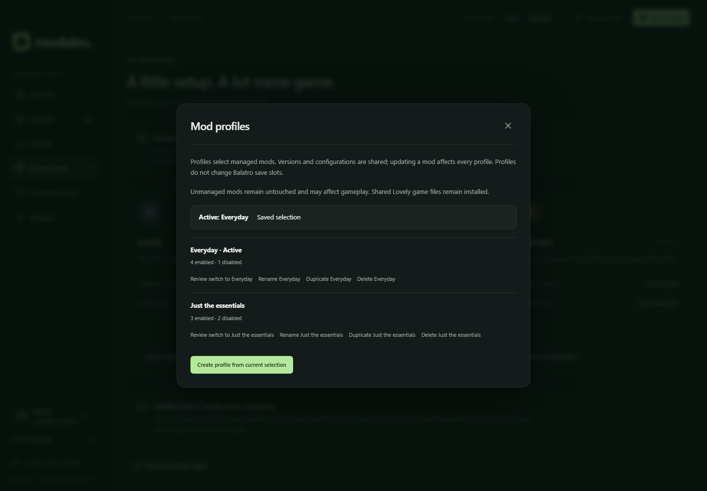
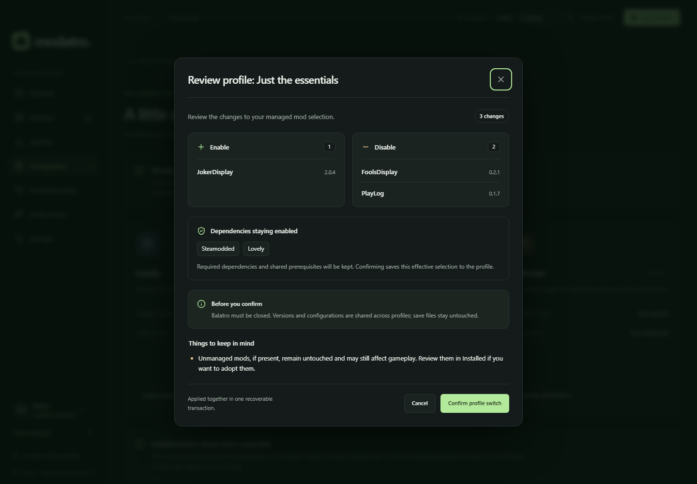

# Named mod profiles

Use the **Profile** selector beside Launch to review a switch. **Manage profiles**
creates a profile from the current managed selection and offers rename, duplicate
and delete actions. Names must be unique, ignoring case and Unicode normalization,
and contain 1–60 characters. Up to 100 profiles are supported.

Deleting a profile leaves installed mods alone. Deleting the active profile requires
confirmation to preserve the current selection as a new Default profile.

## What a profile shares

A profile records enabled or disabled states by stable managed installation identity,
including source-qualified identities. Installed versions and configurations are
shared: updating a mod affects all profiles using it. This includes locally created
mods; switching does not restore an older creator build. Profiles are separate from
Balatro save slots and never move or replace saves. Back up saves separately.

Unmanaged mods remain untouched and can still affect gameplay. Review them in
**Installed** and use the existing adoption action where supported. Lovely's native
game files remain installed as a shared prerequisite. Other game-file replacements
cannot safely be disabled through profiles; review their normal uninstall workflow.

Successful installs automatically save the installed mods and any newly installed
dependencies as enabled in the active profile. Each new managed mod is also recorded
as disabled in every inactive profile; existing choices in those profiles are preserved.
Adopting an external mod follows the same rule. File changes and the saved install
selections commit together, so a failed installation cannot leave a partially updated
profile. Uninstalling removes the mod from every saved selection, whether enabled
or disabled, in the same transaction as its files. A failed uninstall preserves both.
Unrelated unsaved manual changes stay unsaved.

## Review and apply a selection

1. Close Balatro and choose a profile, or choose **Review switch** in profile management.
2. Review every enable and disable, retained dependency, warning and blocker.
3. Confirm the effective selection. The saved profile adopts any required managed
   dependencies retained by the reviewed plan.

The preview separates Enable and Disable lists, shows dependencies staying enabled,
and groups warnings and blockers before the confirmation controls.

Managed mods absent from the saved profile are previewed for disabling where safe.
Already installed required dependencies are retained or enabled; missing dependencies
are never downloaded by switching. Missing mods, incompatible or unknown versions,
ambiguous identities, external changes and unsafe destinations block the switch.
Follow **Review Prerequisites** or **Review Installed mods**, then use Discover or
the normal installation workflow to resolve missing packages. Review a fresh preview
after any change. Confirmation expires after five minutes and is single-use.

Switches commit the file moves and active profile together. A failure restores the
previous selection. After an interruption, startup completes or rolls back the
recorded transaction. If external edits or missing backups block recovery, keep the
application data and open **Troubleshooting**.
During a switch, the dialog shows progress and cannot be dismissed with Close,
Cancel, Escape or a click outside. It closes after success; a failed switch leaves
the controls available again. Empty folders left by earlier switches are ignored
by discovery, and new switches remove empty source directories after committing.

## Unsaved selections

Manual enables and disables show **Unsaved changes** when the current selection
differs from the active profile. This persists across restarts; version-only updates
do not count as selection changes.

- **Save to profile** records the current selection in the active profile.
- **Save as new profile** captures the current selection under a new active name.
- **Revert to saved selection** opens the same reviewed, transactional switch.

## Sharing and backing up profiles

**Export** saves a selected profile to a location you choose. **Import profile from
file** checks its format and checksum, reviews required downloads, installs prerequisites
before dependent mods, then activates a new profile. Existing names gain `(2)`,
`(3)`, etc. Save or revert unsaved selections before importing.

Exports contain managed selections and source/version references. Mod settings,
Balatro saves and local ZIP contents need separate backups. Local-only mods require
their ZIP; missing index entries require the sender's index. Incompatible installed
versions or unavailable releases block import. Cancel before confirmation to restore
the previous selection. The checksum detects corruption, not a trusted sender.

## State upgrade

Older application state is backed up before upgrading to schema 3. A Default profile
captures the existing managed selection. Ownership, file backups, provenance and
recovery records remain intact; migration does not move game or mod files.

Prepared journals are recovered against the unchanged old state before migration.
A backup or state-write failure locks file operations and preserves recovery material.
Keep the entire application-data directory when upgrading. Older Modatro versions
do not understand schema 3; avoid running an older build against upgraded app data.
