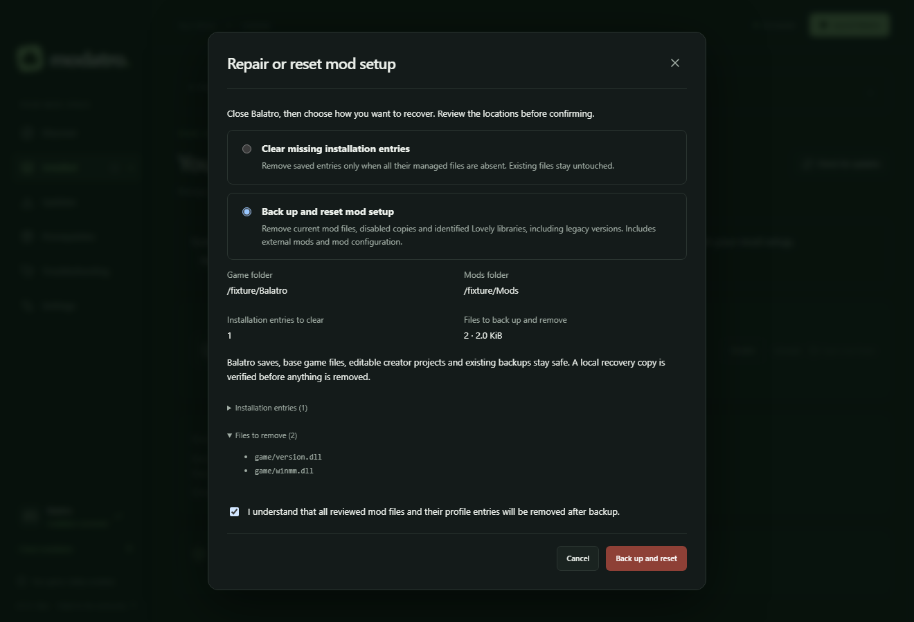

# Troubleshooting

Start with the exact message shown by Modatro. The sections below explain common
setup and file-operation problems. For installation instructions, see
[release information](release.md).

## Inspect your setup and prepare a report

Open **Troubleshooting** in the sidebar and choose **Refresh setup checks** to review
the game, prerequisites, installed mods, active profile and recent operations.

The **Setup overview** groups installed mods into **Enabled mods**, **Disabled mods**,
and, when needed, **Enabled state unknown**. Each group retains the mod identity,
version and managed/unmanaged status. Prerequisite badges show only installed
Balatro, Lovely, Steamodded and Talisman; ordinary mods appear in the grouped lists.
Missing required dependencies appear as findings.

If setup or profile selection changes while this page is open, it marks the displayed
checks as needing refresh. Generating a report always takes fresh checks under the lock.

Enabled state is unknown for unmanaged or unverified files; their presence does not
prove that the loader has enabled them. An unreadable file is an integrity warning,
while verified missing or changed managed files are reported as problems.

**Verified problems**, **Warnings and unknowns**, and **Possible causes from log
evidence** are separate. Each finding explains its observation, relevance and next
action. A mod referenced in a traceback is not proof that it caused the crash.
Modatro log findings use each event's timestamp and the current app session. Errors
from earlier sessions remain in selected excerpts, without appearing as current failures.
Actions link to normal management pages; checks do not install, disable or delete mods.

Log content is excluded initially. Select up to five logs and choose **Read selected
excerpts**, or use **Choose saved text log** through the native picker. Discovery
uses the approved Mods folder, not an arbitrary renderer path. Supported locations
are documented by [Lovely](https://github.com/ethangreen-dev/lovely-injector) and
[Steamodded logging](https://docs.smods.dev/API%20Documentation/Logging/):

| Setup                 | Loader log location relative to its configured Mods folder                         |
| --------------------- | ---------------------------------------------------------------------------------- |
| Windows               | `%APPDATA%/Balatro/Mods/lovely/log`                                                |
| macOS                 | `~/Library/Application Support/Balatro/Mods/lovely/log`                            |
| Steam / Proton / Wine | The chosen prefix's `AppData/Roaming/Balatro/Mods/lovely/log`                      |
| Native Linux loader   | The chosen Mods folder's `lovely/log`; Lovely documents `~/.local/share/love/Mods` |

Modatro's own logs are in its application-data `logs` folder. There is no assumed
universal Balatro crash-log filename: a crash may only appear on screen, while
macOS/Linux console output may need to be saved manually. Patch dumps are not logs.
Linux game installation and launching continue to use the supported Proton workflow.

The picker lists recent text logs and reads bounded excerpts. Missing, rotated,
binary or inaccessible logs produce an explanation. Logs remain plain text and are
never executed. Older logs are marked explicitly; timestamps alone do not identify
the latest game session.

Choose **Generate support report** to build a Markdown report with the current
selection of excerpts and the sections chosen under **Report contents**. Application,
profile, mod, finding and operation sections can each be excluded. Inspect and edit
it, then **Copy report** or **Export report**.
Export opens a native save dialog and writes only your reviewed text to `.md` or
`.txt` outside game, Mods and application-data folders, protecting managed files and
recovery records. Removing a log selection excludes it from a newly generated report. Modatro redacts known home,
game, Mods and application-data roots, common usernames and token patterns, while
retaining relative mod identifiers. Automated redaction may be incomplete; inspect
the report before sharing it. Reports are not uploaded or sent to an AI service.

History stores the last 100 file operations, including updates and profile switches,
with timestamps, identities, outcomes and recorded version changes. An operation
without a verified completion is **uncertain**. History retention never removes
transaction recovery journals or backups. Older operations before this feature may
not appear; corrupted or unavailable history cannot certify an operation's outcome.

For profile blockers, shared versions, unsaved changes and interrupted switches, see
[named mod profiles](profiles.md).

## Modatro will not start

If an earlier build reports **“A file resolves outside its approved location.”** on
startup, install the corrected build. The startup fix separates the catalogue cache
from Electron's `Cache` folder and accepts filesystem case aliases. Keep your existing
application data; deleting it removes installation records and backups.

If startup still fails, include the full error, Modatro version and operating system
in a [bug report](https://github.com/NorthernBranch/modatro/issues). Application data is
normally under `%APPDATA%\Modatro` on Windows or
`~/Library/Application Support/Modatro` on macOS. Development builds may use the
lowercase folder name `modatro`. Linux uses Electron's application-data directory
under `$XDG_CONFIG_HOME` or `~/.config/`, normally `modatro` or `Modatro`.

## macOS says Modatro is damaged

Earlier preview packages could retain an incomplete Electron signature after
packaging. The app could start in a development smoke test while failing macOS's
signature checks once downloaded. Updated builds sign the complete app, including
nested frameworks and helper apps, and verify that signature before publication.

Download a newly built DMG from the project's Releases page, choose the correct
architecture, quit Modatro and replace the app in Applications. Keep application
data and backups. Compare the download with that release's `SHA256SUMS.txt`; a matching
checksum establishes download integrity, not an Apple-verified publisher.

Check the release's signing status. An ad-hoc beta build is not notarized and may still
be blocked by Gatekeeper. For a valid beta build from this project's release that you
choose to trust, Apple's documented **System Settings → Privacy & Security → Open
Anyway** procedure may be available after attempting to open it. This does not
repair an invalid signature. If the alert remains “damaged,” report the release tag,
architecture and macOS version and use a Developer ID signed, notarized build when
one is available.

See [Apple's explanation of downloaded-app alerts](https://support.apple.com/en-gb/102445)
and [Modatro release signing](signing.md).

## Balatro was not found

**Find automatically** shows **Finding Balatro…** while checking Steam libraries.
If no installation is found, Modatro explains the result and offers manual selection.
You can retry after an error; a failed automatic search does not prevent manual setup.

Use **Settings → Balatro installation → Choose folder** to select the actual game
installation. On Windows it contains `Balatro.exe` and its support files. On macOS,
select `Balatro.app` or the folder containing it. A folder named Balatro without the
game files will not pass validation. On Linux, select the Steam/Proton Windows game
directory and its Proton Mods folder; see [Linux and Steam Deck setup](linux.md).

If Steam moved the game, select its current location. Modatro needs read and write
access to that folder. Managed mods must be uninstalled before changing the approved
folders because their installation records refer to the existing locations.

## A prerequisite is missing or its version is unknown

Open **Prerequisites**, follow the linked project instructions, and choose
**Check prerequisites again**. Lovely offers **Install Lovely**, or **Manage Lovely**
for an existing manual copy, using official platform-specific releases.

Installed status and version compatibility are separate checks. If a mod requires a
specific version and the local files do not prove it, Modatro asks you to check it.
Thunderstore package versions and loader versions are separate: adopting an external
copy does not prove which registry package it came from. **Install catalogue release**
records that package version without guessing; existing edits are still protected.
For installed Lovely and Steamodded versions that cannot be verified, installing,
updating or enabling a mod offers **Proceed at my own risk**. Continuing may cause
crashes or prevent mods from working. Your choice applies only to that operation;
it does not mark the version as verified. Missing prerequisites, known incompatible
versions and unverified versions of other dependencies still block the action.
Check the mod's upstream instructions for the supported prerequisite version. Direct
install/update actions appear when a supported catalogue release meets the requirement;
external installations must be adopted first. A failed latest-version check preserves
installed status and labels any last known release.

Missing supported dependencies from either the catalogue or downloaded archive are
included in an installation confirmation. Modatro lists their versions and installs
them before the requested mod after approval. Cancelling leaves installed files
unchanged; a failed dependency check blocks the whole plan. An installed loader with
an unknown version still requires explicit verification rather than automatic replacement.

Dependency changes are also checked against affected installed mods, including
disabled and external mods with readable metadata. Conflicts show each mod's declared
requirement and the proposed version; nothing is silently removed or disabled.
Missing metadata means compatibility is unknown, and passing metadata checks does
not establish gameplay compatibility.

Runtime requirements use detected loader metadata, including supported Steamodded
beta and date formats. Balatro's version comes from `version.jkr` in the game archive;
invalid or ambiguous data remains unknown. Package requirements still need evidence
of the corresponding package version.

Modatro verifies a managed Lovely version against the installed binary's recorded
hash. A manual installation may remain unversioned. Lovely writes its reported version
to `Mods/lovely/log` when Balatro starts; an old log does not prove the version of a
DLL that has since been replaced.

## The catalogue will not refresh

Modatro keeps the last validated catalogue when Thunderstore or the GitHub supplement is
unavailable. You can continue browsing it; a first launch without a saved catalogue
needs a successful refresh. Check your connection and try **Refresh** again later.

An unavailable entry means its metadata or installation method could not be verified.
Open the mod's project page for its installation instructions.

## GitHub's request limit was reached

GitHub's unauthenticated API has a shared limit of 60 requests per hour per IP;
other applications or users on the same connection can consume that allowance.
Modatro respects response reset times and shows how long to wait. Repeated refreshes
or restarting cannot reset GitHub's limit. See
[GitHub's rate-limit documentation](https://docs.github.com/en/rest/using-the-rest-api/rate-limits-for-the-rest-api).

Star counts use a smaller persisted request budget and cached results. Recent
release metadata is reused, but expired or unavailable release checks can still
pause an installation. Your installed files and cached catalogue remain available.
Wait for the indicated time, then refresh or retry the action. Raw removal checks
remain separate and are not bypassed by the release cache.

## A mod appears as unmanaged

Modatro found local files without its own installation record. It leaves those files
in place. Adoption is offered for supported metadata-identified folders and standalone
Lua files. A unique catalogue match enables catalogue updates; entries absent from
the catalogue can still be adopted for local management. Duplicate identities,
ambiguous catalogue matches and unidentified directories stay external. Adoption
records current file hashes without inventing an original download or archive hash.

## A mod was removed, blocked or its source disappeared

Modatro keeps installed copies untouched. Author removals and compromised sources
disable new installations and updates; a blocked version can be replaced by a safe
newer release if available. Open the project for context, open the mod folder, or
explicitly uninstall a managed copy. A vanished repository is not evidence of malware.

## Install is unavailable while offline

Catalogue browsing shows the saved refresh time. Thunderstore and the public
repository's removal/release feeds must be reachable for new downloads and updates.
Bundled and saved restrictions remain in effect. Local uninstall and enable/disable
remain available for managed files. Refresh when connected; an older saved catalogue
cannot override a known restriction. Local ZIPs and creator builds do not require a remote catalogue lookup, but still
check installed dependencies and file ownership.

## GitHub downloads and manual installations

Supported Thunderstore packages use their published archives. For packages that ship
unsupported installers, Modatro can use a linked GitHub manual archive, preferring a
unique `-raw.zip` or `-manual.zip` asset. Ambiguous archives remain blocked.

Open a mod's **Versions and builds** to choose an active Thunderstore version or
a supported stable GitHub release. The picker checks published requirements and
suggests a version when those requirements fit; downloaded metadata is checked before
installation. Missing, unpublished or removed historical builds cannot be recovered
from the provider. GitHub history is limited to the most recent 100 releases.

**Try development build** explicitly requests a commit-pinned upstream build.
Modatro checks its actual runtime version and installed-mod requirements, then asks
you to review the full source commit and file changes. Unreleased code can be unstable;
opting in does not override an incompatible requirement. Reopen **Versions and builds**
after cancelling, changing installed mods or a failed attempt. It explains unsupported
development sources; a failed history lookup leaves supported development retries available.

Registry discovery identity and restrictions remain intact, while installation
provenance records the actual GitHub URL, release or commit and archive hash. GitHub
downloads do not invent a Thunderstore package version. Archives still pass the
existing metadata, prerequisite, conflict and file-plan checks. Developer scripts in
`.github` and supported release-script files in `scripts` are excluded; external
installers elsewhere in a mod remain unsupported.

For managed GitHub copies, a verified runtime version can satisfy a requirement for
the same recorded package identity. Saved dependencies from the installed archive are
checked instead of borrowing the latest registry package's dependency tree. Unmanaged
mods cannot satisfy another namespace's requirements by sharing a name.

## A mod reports that it was installed incorrectly or is nested

Some release ZIPs contain an outer wrapper with instructions or an error patch,
and the actual mod in a child folder. Current root detection prefers structured mod
metadata over those outer filename hints, preserving patch-only mods and rejecting
ambiguous archives. The mod's entry point and Lovely patches are installed together
at the correct depth.

If an earlier Modatro build installed the wrapper, update Modatro, then uninstall
and reinstall the affected mod. Review changed-file conflicts before proceeding.
Moving recorded files by hand can leave the ownership record inconsistent; keep
backups and use Modatro's management actions where possible.

## A release's archive hash changed

Automatic installation stops if an immutable release's archive differs from the
recorded or author-supplied SHA-256. Existing files are untouched. Compare the expected
and received hashes in the error details and consult the author or report the change.
Do not clear integrity history merely to dismiss the warning.

## Installed lists mods whose files are missing

Reinstalling Modatro keeps its saved installation records and backups. If mod files
were deleted or moved separately, the old entries can remain while Prerequisites
correctly reports them missing. Check the game and Mods locations in Settings first.

Choose **Repair or reset setup** in Installed, Troubleshooting, or Settings:

- **Clear missing installation entries** removes all fully missing managed entries
  and their profile references together. Existing files are left alone.
- **Back up and reset mod setup** clears the reviewed Mods folder, disabled copies
  and identified Lovely libraries, including Windows `winmm.dll` and legacy
  `version.dll`. It includes external mods and mod configuration.

Close Balatro and review the locations and file list before confirming. Recovery
copies are verified before removal; failed operations roll back. Saves, base game
files, application settings, creator projects and existing backups are preserved.
A DLL using a Lovely filename must be identified before removal. Links and
unsupported game-file replacements block a reset.
The default Mods folder can be recreated if missing; moved custom folders must be
selected again in Settings.

**Open backups** shows the local copy under `backups/setup-resets/`. Its `files/`
tree mirrors the previous locations and its manifest preserves installation records
and original-file backups for manual recovery. These copies remain until removed
manually, separately from Recently uninstalled retention. Files already missing
before recovery cannot be recovered from the new copy.

## Uninstall reports changed files

A recorded file has changed since installation. Review each conflict before choosing:

- **Keep** preserves the current file and removes Modatro's ownership of it.
- **Restore** overwrites a changed replacement with its verified original backup.
  This choice is available only when an original can be restored.

Keep is selected by default. After uninstall, the report lists preserved edits and
untracked files from that mod; these are no longer managed. Empty-directory cleanup
problems are reported separately. Uninstall also removes the mod from every profile.

Required originals remain under **Settings → Open backups** while referenced by
installation or recovery records. Unused transaction backups are pruned automatically.
Before uninstalling, Modatro also saves the recorded mod files and installation
metadata. If that backup fails, uninstall stops. Use **Installed → Recently uninstalled →
Review restore** to check and restore a copy without downloading it again. Changed
destinations and incompatible requirements block restoration; install missing dependencies
first. Recovery copies are temporary: startup and uninstall remove the oldest eligible
copies above 20 backups or 1 GiB. A copy larger than 1 GiB may be cleaned up immediately
after uninstall. The panel shows sizes and provides **Delete backup** and **Clear all**
with confirmation; deletion ends recovery from those copies. Required originals remain
protected, including during Clear all. Warnings explain retained or unreadable records
and any storage above the limits; **Refresh backups** rereads the list. If deletion fails,
check permissions and retry. If removal was interrupted, retained files may be incomplete;
keep them for investigation. This cannot recover mods removed before uninstall backups
were introduced. Balatro saves need a separate backup.

## Creator source or builds need attention

If a save reports that the project changed on disk, keep the editor text elsewhere
before reloading. Reloading preserves disk changes and treats externally edited
`main.lua` as custom code. Save it before building. Returning to a template requires
confirmation and preserves the prior custom source in project history.

A valid syntax result is not a game test. For a crash, close Balatro, inspect the
loader log and restore a previous build through **Build history and export → Install
this build** if needed. Uninstalling keeps the project; archiving a project keeps
its installed mod. Disabling the feature hides the creator without deleting either.
See [Mod Creator](mod-creator.md) for limits, source recovery and save-backup guidance.

## File operations are locked after recovery

Modatro could not verify saved state, a transaction, a destination or a backup. Keep
the application data folder intact, including `data/`, `backups/` and `transactions/`.
Do not delete the journal or edit installation records to dismiss the message.

Use **Settings → Copy diagnostics** and **Open logs** to collect details for a bug
report. Review attachments for personal information before posting. Include what
operation was interrupted and whether any files were edited afterward.

## Balatro is still running

Close the game, then use **Check again** to retry the requested operation. Game
launch and mod changes share an operation lock, so wait for an active installation
to finish before launching.
